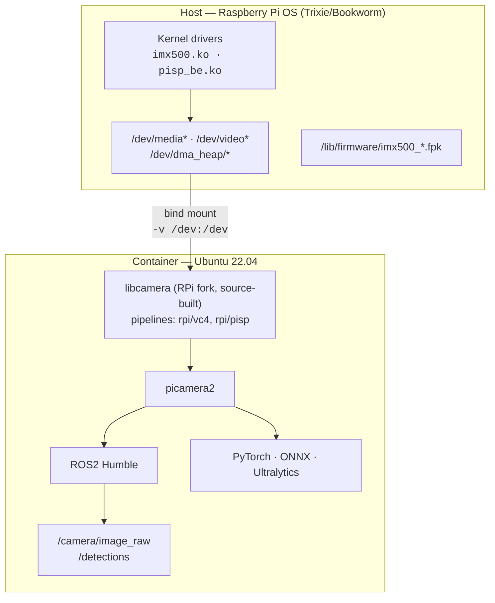
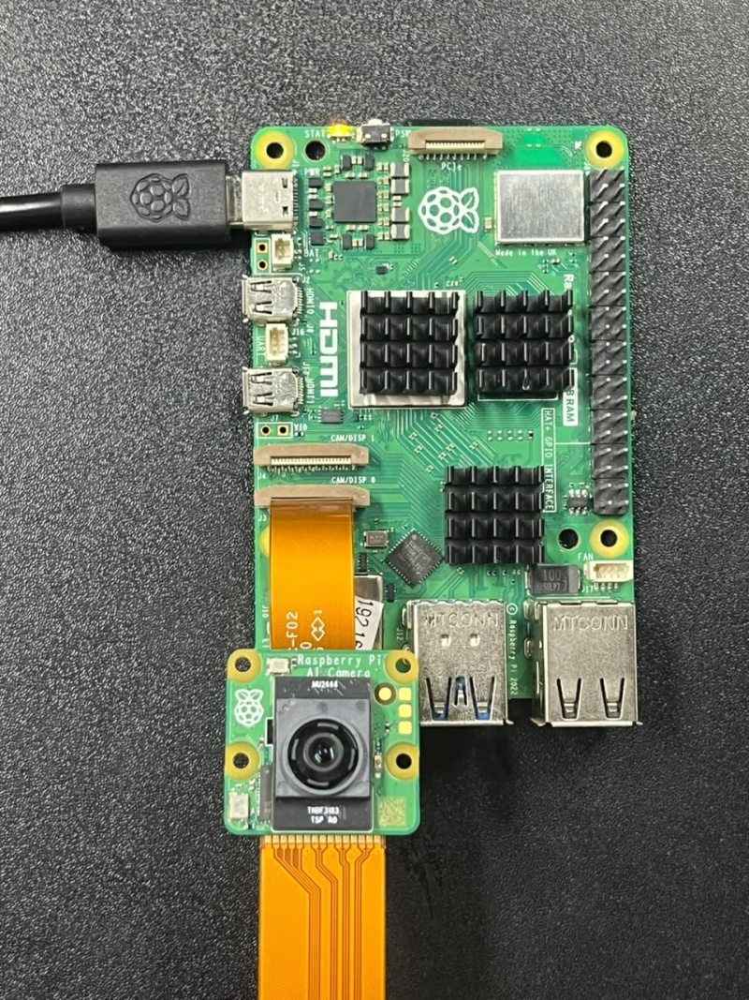
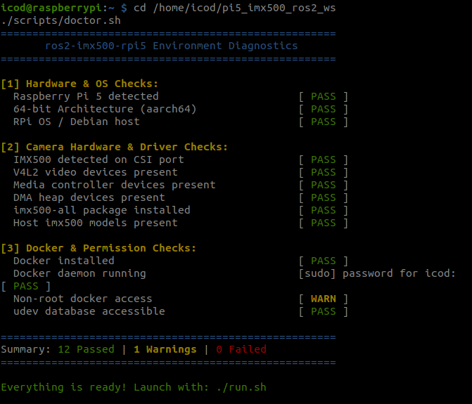

# 🎯 ros2-imx500-rpi5

**Run the Sony IMX500 AI Camera with ROS2 Humble on Raspberry Pi 5 — fully Dockerized.**

[](LICENSE)
[]()
[](https://docs.ros.org/en/humble/)
[](https://www.docker.com/)

> Source-builds the Raspberry Pi fork of **libcamera** (with Python bindings) inside Ubuntu 22.04, so you get full IMX500 camera access + on-chip AI inference + the entire ROS2 ecosystem — all in one container.

---

## 📑 Table of Contents

- [What's Inside](#-whats-inside)
- [Why This Exists](#-why-this-exists)
- [Features](#-features)
- [Architecture](#-architecture)
- [Quick Start](#-quick-start)
- [Prerequisites](#-prerequisites)
- [Building Locally](#-building-locally)
- [Running the Container](#-running-the-container)
- [Image Tags](#-image-tags)
- [Included ROS2 Packages](#-included-ros2-packages)
- [Verified Performance](#-verified-performance)
- [Example: Running IMX500 Inference](#-example-running-imx500-inference)
- [Known Limitations / Gotchas](#-known-limitations--gotchas)
- [Contributing](#-contributing)
- [License](#-license)

---

## 📦 What's Inside

| Component | Version / Details |
|---|---|
| **Base OS** | Ubuntu 22.04 (Jammy) |
| **ROS2** | Humble Hawksbill |
| **libcamera** | v0.7.2+rpt20261009 (Raspberry Pi fork, source-built) |
| **picamera2** | Latest (Python camera interface) |
| **OpenCV** | 4.5.4 (system apt package, with Qt5 GUI) |
| **PyTorch** | CPU build (aarch64) |
| **ONNX Runtime** | Latest |
| **Ultralytics** | YOLO framework |
| **MAVROS** | ROS2 ↔ MAVLink bridge |
| **GStreamer** | Full plugin set (good, bad, ugly, libav) |

---

## 🧩 Why This Exists

The **Sony IMX500** is a 12.3 MP image sensor with a **built-in neural network accelerator**. It connects to the Raspberry Pi 5 via CSI and offloads inference from the Pi's CPU entirely — the camera itself runs your model.

The problem:

```
  IMX500 camera firmware     →  ships with Raspberry Pi OS only
  libcamera (RPi fork)       →  built for Pi OS (Bookworm/Trixie)
  picamera2 device support   →  depends on RPi libcamera fork
  ROS2 Humble                →  officially targets Ubuntu 22.04
```

**There is no native way to get ROS2 and the IMX500 on the same system.** You either run Pi OS (no ROS2 packages) or Ubuntu (no camera support).

This project bridges the gap:

- ✅ Takes the `ros:humble-ros-core` Ubuntu 22.04 image
- ✅ Source-builds the **Raspberry Pi fork** of libcamera with `rpi/pisp` pipeline and Python bindings (`pycamera`)
- ✅ Installs `picamera2` and the full ML/robotics stack
- ✅ Bind-mounts host device nodes so the container can talk to the camera hardware
- ✅ Leaves the Pi 5 CPU free for ROS2 navigation, SLAM, planning, etc.

---

## ⚡ Features

- **Full IMX500 camera access** — 12 MP capture, on-chip AI inference, sensor metadata readback
- **Pre-built ML stack** — PyTorch (CPU), ONNX Runtime, Ultralytics YOLO, scipy, polars
- **ROS2 Humble** with MAVROS, cv_bridge, vision_msgs, camera_ros, apriltag_ros, v4l2_camera
- **GStreamer pipeline support** — full plugin set for RTMP, HLS, and custom pipelines
- **Non-root execution** — runs as `ros` user (UID 1000) with `video`, `dialout`, and `audio` group access
- **Proper DMA heap handling** — entrypoint creates the `vidbuf_cached` symlink for reliable buffer allocation
- **Dynamic device-major detection** — cgroup rules work across kernel versions where major numbers shift
- **Health check built in** — Docker `HEALTHCHECK` verifies `picamera2` import every 60 s
- **colcon build tools** — develop your own ROS2 packages inside the container

---

## 🏗 Architecture



---

## 🚀 Quick Start

```bash
# 1. Clone the repo
git clone https://github.com/<username>/ros2-imx500-rpi5.git
cd ros2-imx500-rpi5

# 2. Build the image
docker build -t ros2-imx500-rpi5:humble .

# 3. Run (see "Running the Container" for full flag reference)
./run.sh bash

# 4. Inside the container — verify camera access
cam -l                    # Should list: imx500
python3 -c "
from picamera2 import Picamera2
picam2 = Picamera2()
picam2.start()
arr = picam2.capture_array()
print(f'Captured frame: {arr.shape}')
picam2.stop()
"
```

> [!NOTE]
> Replace `<username>` with your GitHub / Docker Hub username throughout this README.

---

## 📋 Prerequisites

<p align="center">
  
  <br/><em>Hardware setup: Raspberry Pi 5 with Sony IMX500 AI Camera connected via CSI port</em>
</p>

| Requirement | Details |
|---|---|
| **Hardware** | Raspberry Pi 5 (8 GB recommended, 4 GB works) |
| **Camera** | Sony IMX500 connected to a CSI port |
| **Host OS** | Raspberry Pi OS **Trixie** or **Bookworm** (NOT Ubuntu — the host needs kernel drivers) |
| **Docker** | Installed on the host (`curl -fsSL https://get.docker.com \| sh`) |
| **IMX500 firmware** | `sudo apt install imx500-all` on the host |

### Automated Environment Diagnostics

Before running the container, verify your host kernel, CSI detection, and permissions using `doctor.sh`:

```bash
./scripts/doctor.sh
```

<p align="center">
  
  <br/><em>All-green environment diagnostics check</em>
</p>

> [!IMPORTANT]
> The host **must** run Raspberry Pi OS. The kernel drivers (`imx500.ko`), firmware blobs, and PiSP back-end are loaded by the host. Ubuntu as the host will **not** work.

---

## 🔨 Building Locally

```bash
# Standard build (~6 GB, includes PyTorch, Ultralytics, MAVROS, VTK, scipy)
docker build -t ros2-imx500-rpi5:humble .
```

<details>
<summary><strong>Multi-stage build targets (if using the multi-stage Dockerfile)</strong></summary>

```bash
# Base image — slim (~2.5 GB)
docker build --target base -t ros2-imx500-rpi5:base .

# Full image — everything (~6 GB)
docker build --target full -t ros2-imx500-rpi5:full .
```

| Target | Contents | Approx. Size |
|--------|----------|-------------|
| `base` | ROS2 + libcamera + picamera2 + OpenCV + ONNX Runtime | ~2.5 GB |
| `full` | Everything in base + PyTorch, Ultralytics, MAVROS, VTK, scipy | ~6 GB |

</details>

> [!TIP]
> The build runs on aarch64 and takes **30–60 minutes** on a Pi 5 (most of the time is the libcamera source build). Use `DOCKER_BUILDKIT=1` for faster layer caching on rebuilds.

---

## 🏃 Running the Container

### Using `run.sh` (recommended)

```bash
./run.sh bash          # Interactive shell
./run.sh ros2 launch … # Run a ROS2 launch file directly
```

The script handles all required device mappings, cgroup rules, and network configuration automatically.

### Manual `docker run`

<details>
<summary><strong>Click to expand the full <code>docker run</code> command with explanations</strong></summary>

```bash
docker run -it --rm \
    --name ros2-imx500 \
    \
    # ── Device access ──────────────────────────────────────────────
    -v /dev:/dev \                           # All device nodes (camera, serial, DMA heaps)
    -v /run/udev:/run/udev:ro \             # udev database — libcamera uses this for device enumeration
    \
    # ── Cgroup rules for device major numbers ─────────────────────
    --device-cgroup-rule='c 81:* rwm' \     # video4linux (/dev/video*)
    --device-cgroup-rule='c 235:* rwm' \    # media controller (/dev/media*) — may be 510 on some kernels
    --device-cgroup-rule='c 510:* rwm' \    # media controller (alternate major)
    --device-cgroup-rule='c 252:* rwm' \    # dma_heap (/dev/dma_heap/*)
    --device-cgroup-rule='c 226:* rwm' \    # DRM/render nodes
    \
    # ── Kernel device-tree access ─────────────────────────────────
    --security-opt systempaths=unconfined \  # Grants access to /sys/firmware/devicetree (needed by libcamera)
    \
    # ── Networking ────────────────────────────────────────────────
    --network host \                         # Required for ROS2 DDS discovery (multicast)
    \
    # ── Display forwarding (optional) ────────────────────────────
    -e DISPLAY=$DISPLAY \
    -v /tmp/.X11-unix:/tmp/.X11-unix:rw \
    \
    ros2-imx500-rpi5:humble bash
```

> [!WARNING]
> If `--device-cgroup-rule` major numbers don't match your kernel, the container will fail to open the camera. Check your host with:
> ```bash
> ls -la /dev/video* /dev/media*   # note the major numbers in column 5
> ```

</details>

### Using Docker Compose

<details>
<summary><strong>Click to expand <code>docker-compose.yml</code></strong></summary>

```yaml
version: "3.8"

services:
  ros2-imx500:
    image: ros2-imx500-rpi5:humble
    build: .
    container_name: ros2-imx500
    stdin_open: true
    tty: true
    network_mode: host
    security_opt:
      - systempaths=unconfined
    volumes:
      - /dev:/dev
      - /run/udev:/run/udev:ro
      - /tmp/.X11-unix:/tmp/.X11-unix:rw
    environment:
      - DISPLAY=${DISPLAY}
    device_cgroup_rules:
      - "c 81:* rwm"
      - "c 235:* rwm"
      - "c 510:* rwm"
      - "c 252:* rwm"
      - "c 226:* rwm"
```

```bash
docker compose up -d
docker compose exec ros2-imx500 bash
```

</details>

---

## 🏷 Image Tags

| Tag | Contents | Size |
|-----|----------|------|
| `base` / `humble` | ROS2 Humble + libcamera (RPi fork) + picamera2 + OpenCV 4.5.4 + ONNX Runtime | ~2.5 GB |
| `full` | Everything in `base` + PyTorch (CPU), Ultralytics, MAVROS, MAVProxy, VTK, scipy | ~6 GB |

```bash
# Pull from Docker Hub
docker pull <username>/ros2-imx500-rpi5:humble
docker pull <username>/ros2-imx500-rpi5:full
```

---

## 📦 Included ROS2 Packages

All packages are from the official `ros-humble-*` apt repository:

| Package | Purpose |
|---------|---------|
| `ros-humble-mavros` | MAVLink ↔ ROS2 bridge for autopilots |
| `ros-humble-mavros-extras` | Additional MAVROS plugins (GPS, vision pose, etc.) |
| `ros-humble-v4l2-camera` | V4L2 camera driver node |
| `ros-humble-usb-cam` | USB camera driver node |
| `ros-humble-image-transport-plugins` | Compressed / theora image transport |
| `ros-humble-cv-bridge` | OpenCV ↔ ROS2 image conversion |
| `ros-humble-camera-info-manager` | Camera calibration YAML loader |
| `ros-humble-image-geometry` | Pinhole camera model utilities |
| `ros-humble-apriltag-ros` | AprilTag fiducial detection |
| `ros-humble-camera-ros` | Generic libcamera-based camera node |
| `ros-humble-camera-calibration` | Monocular/stereo camera calibration tool |
| `ros-humble-vision-msgs` | Standard detection/classification message types |

**Build tools:** `python3-colcon-common-extensions`, `python3-colcon-mixin`, `python3-rosdep`, `python3-vcstool`

---

## 📊 Verified Performance

Tested on Raspberry Pi 5 Model B Rev 1.1 (Debian 13 Trixie host, Ubuntu 22.04 container):

| Metric | SSD MobileNetV2 | YOLO11n Base | Notes |
|---|---|---|---|
| **Video Capture Rate** | **30.0 fps** | **30.0 fps** | Continuous 640x480 stream |
| **On-Chip Inference** | **15.0 fps** | **7.5 fps** | Processed entirely on IMX500 DSP |
| **Inference Cadence** | 1 every 2 frames | 1 every 4 frames | Predictable hardware timing |
| **Input Tensor Size** | 320x320 | 640x640 | Hardware pre-scaled |
| **Pi 5 CPU Load** | **< 3%** | **< 3%** | Free for ROS 2 SLAM / Nav / Planning |

<p align="center">
  
  
  <br/><em>Live verification: /camera/image_raw running at 30.0 Hz (left) and /detections running at 7.5 Hz on-chip (right)</em>
</p>

> [!TIP]
> Because the IMX500's neural accelerator handles inference entirely on-chip, the Pi 5 CPU remains completely unburdened for complex robotics tasks.

---

## 🧪 Example: Running IMX500 Inference

<details>
<summary><strong>Minimal Python example — object detection with on-chip inference</strong></summary>

```python
#!/usr/bin/env python3
"""
IMX500 on-chip inference example.
Loads an object-detection model onto the IMX500 accelerator,
captures frames, and reads back bounding-box outputs.
"""

import time
import numpy as np
from picamera2 import Picamera2
from picamera2.devices import IMX500
from picamera2.devices.imx500 import NetworkIntrinsics

# ── Configure the IMX500 with a detection model ──────────────
MODEL_PATH = "/usr/share/imx500-models/imx500_network_ssd_mobilenetv2_fpnlite_320x320_pp.rpk"

imx500 = IMX500(MODEL_PATH)
intrinsics = imx500.network_intrinsics or NetworkIntrinsics()
intrinsics.task = "object detection"

picam2 = Picamera2(imx500.camera_num)
config = picam2.create_preview_configuration(
    controls={"FrameRate": intrinsics.inference_rate or 15},
    buffer_count=12,
)
picam2.configure(config)
picam2.start()

print("Waiting for first inference result...")

# ── Capture loop ─────────────────────────────────────────────
try:
    for i in range(100):
        metadata = picam2.capture_metadata()
        detections = imx500.get_results(metadata, show=False)

        if detections:
            print(f"Frame {i}: {len(detections)} detection(s)")
            for det in detections:
                box = det.box  # (x, y, w, h) normalized
                score = det.conf
                label = det.category
                print(f"  → class={label}  conf={score:.2f}  bbox={box}")
        else:
            print(f"Frame {i}: no detections yet")

        time.sleep(0.066)  # ~15 fps
finally:
    picam2.stop()
    print("Done.")
```

Run inside the container:

```bash
python3 imx500_detect.py
```

</details>

---

## ⚠️ Known Limitations / Gotchas

| Issue | Details |
|-------|---------|
| ❌ **`camera_ros` node doesn't work** | The `ros-humble-camera-ros` apt package bundles its own `libcamera v0.1.0`, which conflicts with the source-built v0.7.x. Use **picamera2** directly to publish to ROS2 topics, or rebuild `camera_ros` against the container's libcamera. |
| ❌ **Host must run Pi OS** | The kernel drivers (`imx500.ko`, `pisp_be.ko`) and firmware (`.fpk` files) are loaded by the host OS. Ubuntu as the host OS **will not work**. |
| ⚠️ **CMA pool is limited** | The default `linux,cma` DMA heap is only 64 MB, which can cause buffer allocation failures. The entrypoint script creates a `vidbuf_cached → system` symlink to use the larger system heap instead. |
| ⚠️ **Not for Pi 4 or earlier** | The IMX500 and PiSP (Pi Image Signal Processor) pipeline are **Pi 5 specific**. |
| ⚠️ **Device major numbers vary** | The major numbers for `/dev/media*` can be 235 or 510 depending on kernel version. The `run.sh` script and compose file include both. Check with `ls -la /dev/media*` if you have issues. |
| ⚠️ **Large image size** | The full image is ~6 GB due to PyTorch, GStreamer, Qt5, and ML dependencies. Use the `base` target for a slimmer ~2.5 GB image if you don't need PyTorch/Ultralytics. |

---

## 🤝 Contributing

Contributions are welcome! Here's how to get involved:

1. **Fork** the repository
2. **Create a feature branch:** `git checkout -b feature/my-feature`
3. **Commit your changes:** `git commit -m 'Add my feature'`
4. **Push to the branch:** `git push origin feature/my-feature`
5. **Open a Pull Request**

### Areas where help is appreciated

- 🔧 Rebuilding `camera_ros` against the container's libcamera
- 📸 Adding a ROS2 node that publishes IMX500 detections as `vision_msgs/Detection2DArray`
- 📝 Testing on different Pi 5 + IMX500 configurations
- 🐛 Bug reports with `rpicam-hello --list-cameras` output and `docker logs`

Please open an issue first for major changes so we can discuss the approach.

---

## 📄 License

**MIT License** — Copyright (c) 2026 Abhin M

See [LICENSE](LICENSE) for the full text.

---

<p align="center">
  <em>Built with ❤️ for the robotics community — because your robot deserves both eyes and a brain.</em>
</p>
