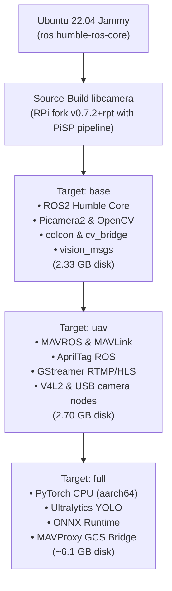

# Multi-Stage Container Builds & Architecture

The `ros2-imx500-rpi5` repository features a multi-stage [`Dockerfile`](../Dockerfile) tailored for different robotics workloads—from lightweight perception nodes to complete autonomous UAV flight stacks.

---

## 1. Multi-Stage Build Architecture



---

## 2. Image Targets Comparison

| Target | Tags | Contents & Capabilities | Disk Size | Download Size | Best Used For |
| :--- | :--- | :--- | :--- | :--- | :--- |
| **`base`** | `base`, `humble`, `latest` | ROS 2 Humble + source-built libcamera + Picamera2 + OpenCV + colcon + `cv_bridge` + `vision_msgs` | **2.33 GB** | **558 MB** | Minimal camera publisher, custom perception nodes, memory-constrained setups |
| **`uav`** | `uav` | Everything in `base` + `mavros`, `apriltag_ros`, GStreamer RTMP/HLS streaming, GUI / X11 tools | **2.70 GB** | **637 MB** | Autonomous drones, precision landing, companion computer flight stacks |
| **`full`** | `full` | Everything in `uav` + PyTorch CPU, Ultralytics YOLO (AGPL-3.0), ONNX Runtime, MAVProxy | **~6.1 GB** | **~1.38 GB** | Onboard model evaluation, development workstations, non-RPK inference |

---

## 3. Building Locally on Raspberry Pi 5

You can build any target locally using Docker on the Raspberry Pi:

### Enable Docker BuildKit for Fast Layer Caching

```bash
export DOCKER_BUILDKIT=1
```

### Build Commands

```bash
# 1. Build Base Target (Perception & Picamera2)
docker build --target base -t ros2-imx500-rpi5:base .

# 2. Build UAV Target (UAV, Precision Landing & MAVROS)
docker build --target uav -t ros2-imx500-rpi5:uav .

# 3. Build Full Target (Full AI & Development Suite)
docker build --target full -t ros2-imx500-rpi5:full .
```

> [!TIP]
> **Compilation Time Notice:**
> The initial build compiles the Raspberry Pi fork of `libcamera` and its Python C++ extension from source. On a Raspberry Pi 5 (8 GB), this takes approximately **35–50 minutes**. Subsequent builds with Docker layer caching enabled will complete in seconds.

---

## 4. Pulling Pre-Compiled Images from GHCR

Pre-compiled, verified multi-arch (`linux/arm64`) images are available directly from the GitHub Container Registry (GHCR):

```bash
# Pull lightweight base image
docker pull ghcr.io/abhinmadhu01/ros2-imx500-rpi5:base

# Pull drone flight stack image
docker pull ghcr.io/abhinmadhu01/ros2-imx500-rpi5:uav

# Pull complete AI suite
docker pull ghcr.io/abhinmadhu01/ros2-imx500-rpi5:full
```

When using [`run.sh`](../run.sh), if no local image is found, it automatically falls back to pulling `ghcr.io/abhinmadhu01/ros2-imx500-rpi5:base`.

---

## 5. Verifying Built Images

After building or pulling, verify image presence on the host:

```bash
docker images | grep ros2-imx500
```

Expected output:

```text
REPOSITORY                          TAG       IMAGE ID       CREATED         SIZE
ros2-imx500-rpi5                    uav       3fa81b9e2c41   2 hours ago     2.70GB
ros2-imx500-rpi5                    base      9b1a7d4e56c2   2 hours ago     2.33GB
ghcr.io/abhinmadhu01/ros2-imx500-rpi5 base    9b1a7d4e56c2   2 days ago      2.33GB
```

---

<div align="center">

| [Previous: **03 - Device Access & Dynamic Cgroups**](devices.md) | [**Documentation Roadmap**](../README.md#documentation-roadmap) | [Next: **05 - Running Containers & Orchestration**](running.md) |
| :--- | :---: | ---: |

</div>

