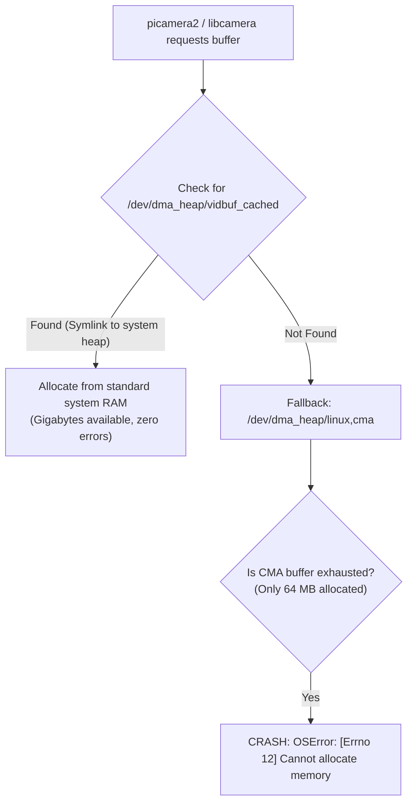

# Device Access, Dynamic Cgroups & DMA Heaps

Running hardware-accelerated cameras inside Docker without `--privileged` requires mapping device nodes, configuring character device cgroups, and managing kernel memory heaps.

---

## 1. The Dynamic Major Number Problem

Linux assigns character device major numbers dynamically for certain kernel subsystems. On Raspberry Pi 5 kernels (Linux 6.6+ and 6.18+), major numbers for camera subsystems frequently shift across kernel upgrades and system reboots:

| Subsystem | Typical Major Number | Device Nodes | Description |
| :--- | :--- | :--- | :--- |
| `video4linux` | `81` (static) | `/dev/video*`, `/dev/v4l-subdev*` | Video capture and subdevice controls |
| `media` | `235` or `510` (**dynamic**) | `/dev/media*` | Media controller pipeline topology |
| `dma_heap` | `252` or `261` (**dynamic**) | `/dev/dma_heap/*` | Hardware DMA buffer allocation pools |
| `drm` | `226` (static) | `/dev/dri/renderD128` | Direct Rendering Manager nodes |

### What Happens With Static Cgroup Flags

If a Docker container is started with hardcoded flags like `--device-cgroup-rule='c 235:* rmw'` on a host where the kernel assigned `media` to major number `510`, the container is blocked by the kernel:

```text
[ERROR] libcamera: Failed to open media device at /dev/media1: Operation not permitted
[ERROR] picamera2: No cameras found on system
```

---

## 2. Dynamic Major Number Detection (`run.sh`)

To eliminate hardcoded assumptions, the provided [`run.sh`](../run.sh) script queries `/proc/devices` dynamically at runtime before launching Docker:

```bash
# Dynamically inspect /proc/devices on the host at launch time:
rules=()
for n in video4linux media dma_heap; do
  m=$(awk -v n="$n" '$2==n {print $1}' /proc/devices)
  if [ -n "$m" ]; then
    rules+=(--device-cgroup-rule="c ${m}:* rmw")
  fi
done
```

This guarantees that whether the host kernel allocates major number `235` or `510` for the media controller, the container receives the exact cgroup permissions needed on that specific boot.

---

## 3. DMA Heap Allocation & The CMA Pool Limit

Image sensor buffers are allocated via Linux Direct Memory Access (DMA) heaps. The allocation sequence behaves as follows:



### The Fix in `entrypoint.sh`

The host's default Contiguous Memory Allocator (`linux,cma`) pool is only **64 MB**, which is quickly exhausted by multi-frame 12 MP camera buffers. 

To resolve this permanently, [`entrypoint.sh`](../entrypoint.sh) executes on container startup:

```bash
# Map vidbuf_cached to the unlimited system DMA heap:
if [ -e /dev/dma_heap/system ] && [ ! -e /dev/dma_heap/vidbuf_cached ]; then
    ln -sf system /dev/dma_heap/vidbuf_cached
fi
```

This ensures that camera frames are backed by general system RAM, completely preventing `Errno 12 Cannot allocate memory`.

---

## 4. Required Mounts & Security Flags

To enable unhindered camera operation without exposing full root host privileges:

### 1. Device Tree Unmasking
```bash
--security-opt systempaths=unconfined
```
*Why it is needed*: Docker by default masks `/sys/firmware` inside containers for security isolation. However, Raspberry Pi's `libcamera` relies on reading `/sys/firmware/devicetree` to enumerate CSI bridge endpoints and match the Sony IMX500 sensor with the PiSP back-end.

### 2. Device Filesystem Mapping
```bash
-v /dev:/dev
```
*Why it is needed*: Gives the container access to `/dev/video*`, `/dev/media*`, `/dev/dma_heap/*`, and serial telemetry ports (e.g., `/dev/ttyUSB0` or `/dev/ttyAMA0`).

### 3. Udev Database Mapping
```bash
-v /run/udev:/run/udev:ro
```
*Why it is needed*: Libcamera queries the host `udev` database to identify hardware capabilities, camera indices, and driver bindings.

---

<div align="center">

| [⬅️ Previous: **02 - Hardware & Avionics Setup**](hardware.md) | [📖 **Documentation Roadmap**](../README.md#documentation-roadmap) | [➡️ Next: **04 - Multi-Stage Container Builds**](building.md) |
| :--- | :---: | ---: |

</div>
