# Hardware & Avionics Setup Guide

Complete hardware reference for connecting the Sony IMX500 AI Camera to the Raspberry Pi 5, configuring power regulation, routing CSI ribbon cables, and integrating with autonomous flight avionics.

---

## 1. Bill of Materials (BOM)

| Component | Model / Specification | Purpose |
| :--- | :--- | :--- |
| **Single Board Computer** | Raspberry Pi 5 Model B (8 GB recommended) | Host computer running Docker, ROS 2 Humble, and Picamera2 |
| **Vision Sensor** | Sony IMX500 AI Camera (Raspberry Pi AI Camera) | 12.3 MP sensor with built-in neural network accelerator |
| **Thermal Solution** | Raspberry Pi Active Cooler | Aluminum heatsink with temperature-controlled PWM blower fan |
| **CSI Interconnect** | 22-pin to 15-pin FPC Ribbon Cable (200 mm / 500 mm) | High-speed MIPI CSI-2 video & I2C control bus |
| **Bench Power Supply** | Raspberry Pi Official 27 W USB-C Power Supply (5.1 V / 5 A) | Stable test bench power preventing undervoltage throttling |
| **Flight Power Converter** | 5 V / 5 A High-Efficiency Step-Down Buck BEC | Regulated avionics power directly from 4S–6S LiPo battery |
| **Flight Controller (Optional)** | CubePilot Cube Orange+ (running ArduCopter / PX4) | Autopilot companion connected via high-speed USB MAVLink |

---

## 2. Key Hardware Components

| Sony IMX500 AI Camera | Official Packaging & Accessories | Raspberry Pi 5 Bare Board |
| :---: | :---: | :---: |
| 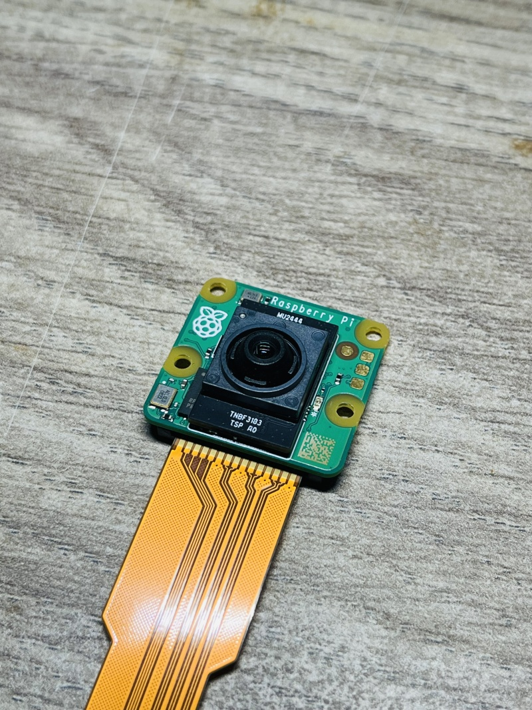 | 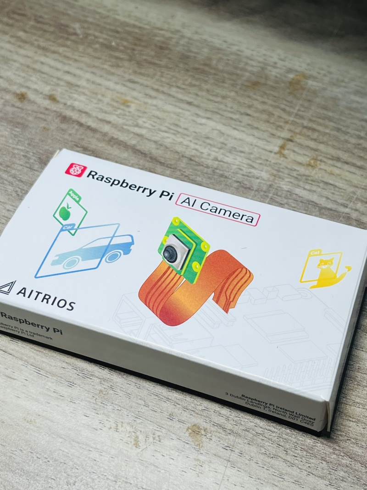 | 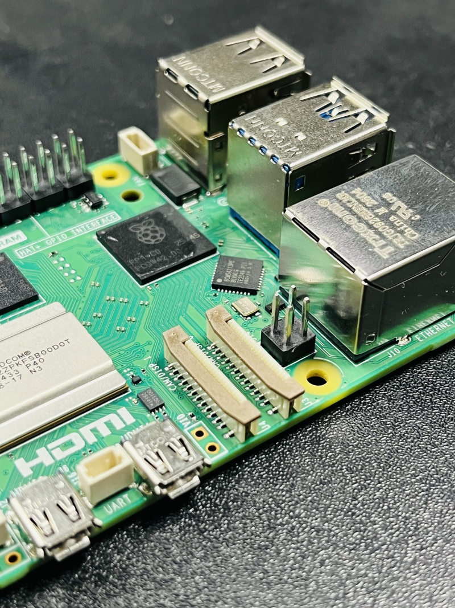 |
| *12.3 MP IMX500 sensor with integrated NPU* | *Factory box with camera module and pre-installed lens* | *RP1 Southbridge, BCM2712 SoC, and dual CSI ports* |

---

## 3. CSI Camera Ribbon Cable Connection

The Raspberry Pi 5 features two dual-purpose 4-lane MIPI CSI/DSI ports (**CAM0** and **CAM1**) using a compact **22-pin 0.5 mm pitch** connector. The IMX500 camera module uses a standard **15-pin 1.0 mm pitch** connector. A specialized **22-to-15 pin adapter ribbon cable** is required.

### Connection Sequence

| Step 1: Cable Insertion | Step 2: Lock CAM0 Port |
| :---: | :---: |
| 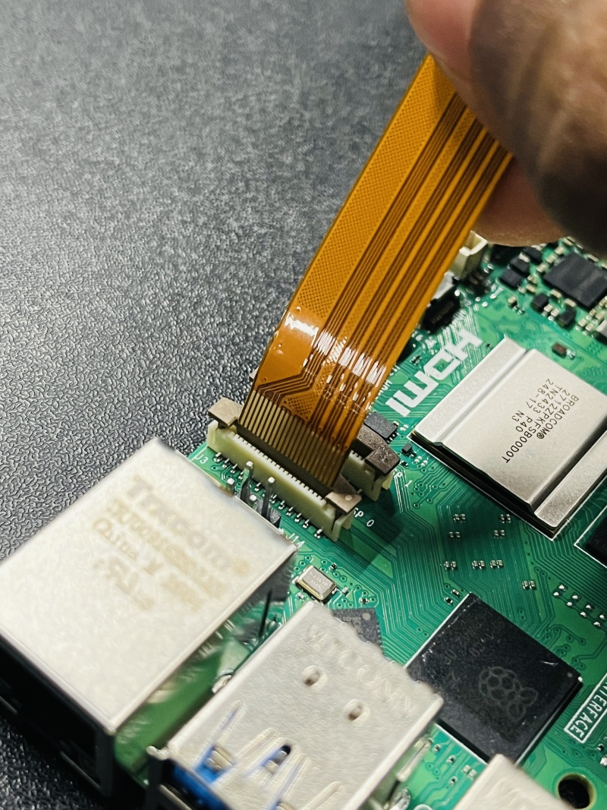 | 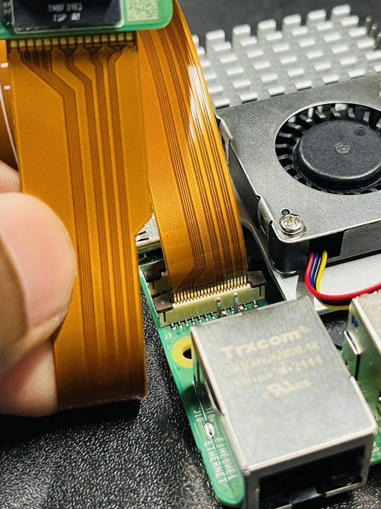 |
| *Gently pull the retaining collar up, insert the ribbon cable squarely with exposed contacts facing towards the board center.* | *Press both sides of the plastic collar down firmly until flush with the connector body to lock the cable.* |

> [!CAUTION]
> Always disconnect power before connecting or disconnecting the CSI ribbon cable. Hot-plugging MIPI CSI cables can permanently damage the RP1 I/O controller or the IMX500 sensor.

### Ribbon Cable Pinout & Orientation

| Ribbon Cable Pinout Verification | Assembled Pi 5 + Active Cooler + Camera |
| :---: | :---: |
| 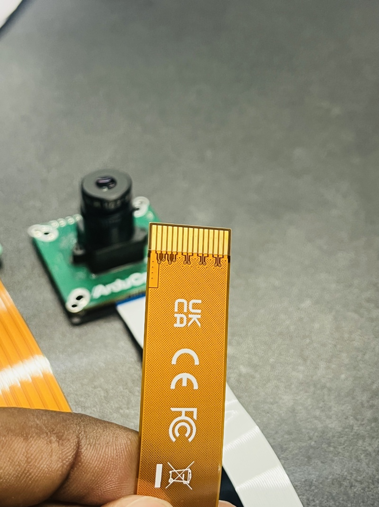 | 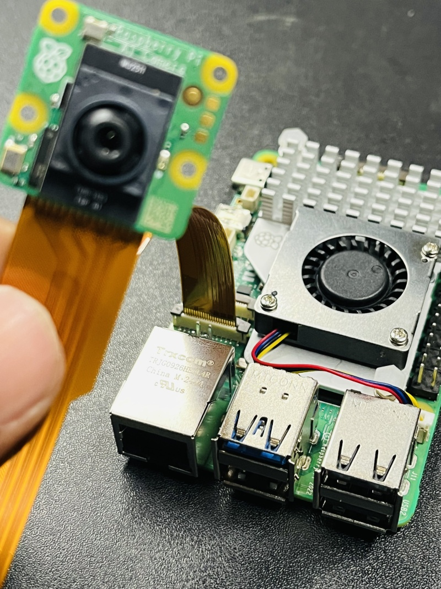 |
| *Check pin integrity on 200 mm and 500 mm FPC cables* | *Complete assembly ready for bench testing and deployment* |

---

## 4. Power Supply & Regulation Architecture

The Raspberry Pi 5 has substantially higher peak power demands than previous generations. Operating under sustained AI inference, ROS message serialization, and video streaming requires a clean, non-sagging power supply:

```text
Bench Testing:
[Wall Outlet] ---> [Official 27W USB-C Adapter (5.1V / 5.0A)] ---> [Raspberry Pi 5]

Flight Deployment:
[4S–6S LiPo Battery] ---> [5V / 5A Step-Down Buck BEC] ---> [Raspberry Pi 5 (USB-C)]
```

| Official 27W USB-C Bench Supply | Heatsinks & IP Labeling |
| :---: | :---: |
| 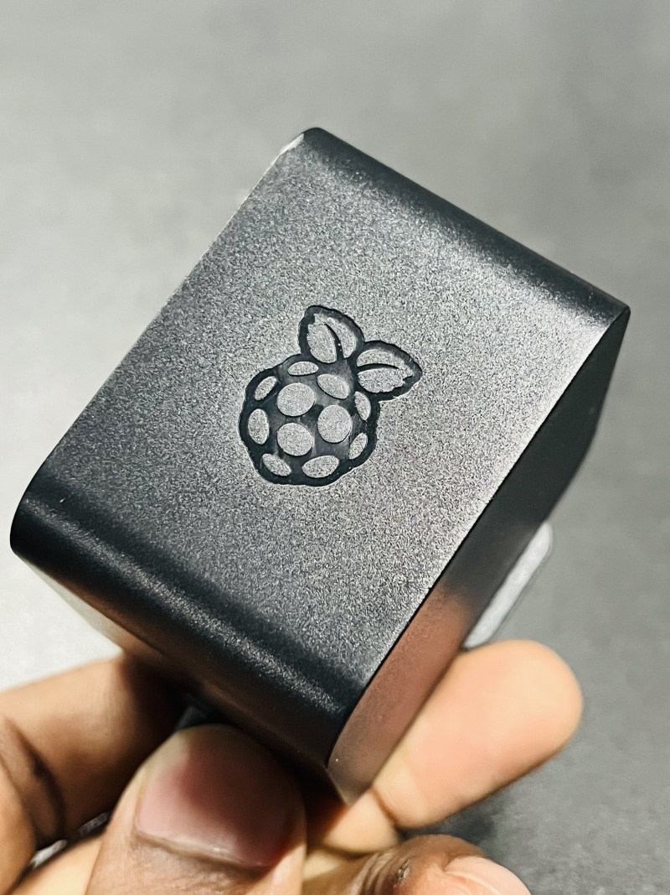 | 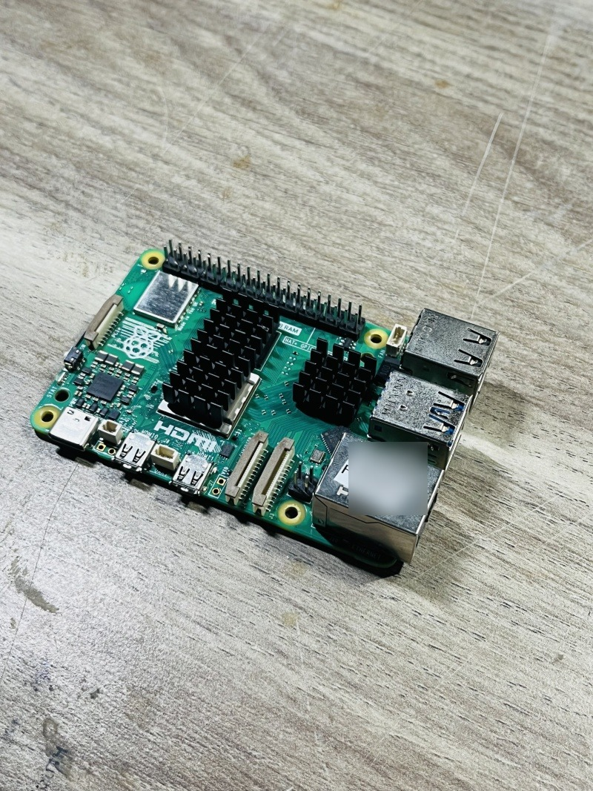 |
| *Provides full 5.1 V / 5.0 A PD profile preventing throttling* | *Network IP labeling and thermal sinks for field operations* |

> [!WARNING]
> **Power Warning for Drone Integration:**
> Never attempt to power the Raspberry Pi 5 from the flight controller's internal 5V telemetry rail or an undersized 3A BEC. Voltage sags below 4.75 V trigger CPU undervoltage throttling (`0x50000`), USB bus brownouts, and companion computer reboots in flight. Always use a dedicated 5V / 5A BEC regulator.

---

## 5. Bench Test Setup & Interconnect

Before vehicle installation, the full hardware stack should be validated on the test bench:

| Complete Bench Test Setup | Autopilot Avionics Interconnect |
| :---: | :---: |
| 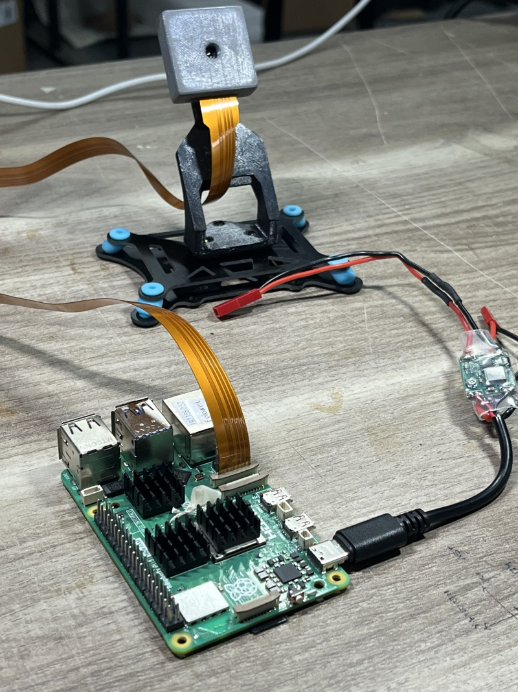 | 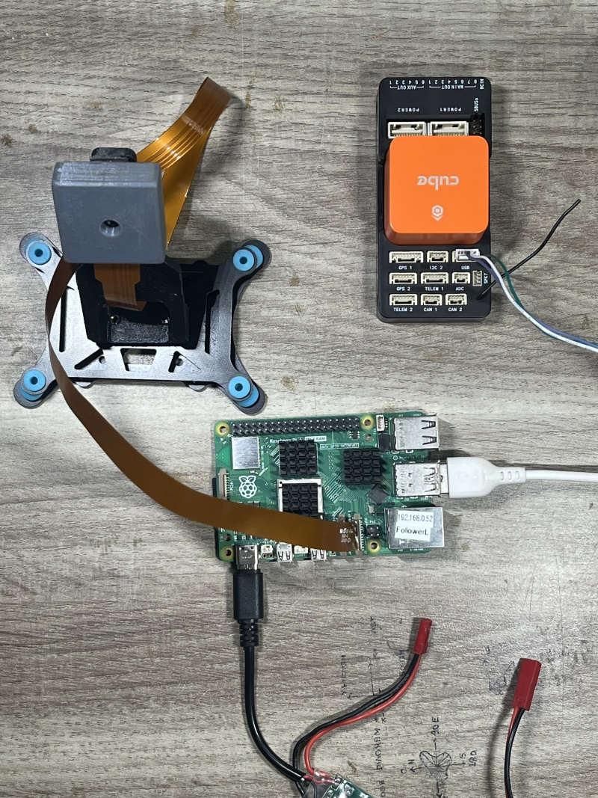 |
| *Raspberry Pi 5, IMX500 AI camera, and dedicated 5V/5A BEC* | *Complete avionics harness connecting Pi 5 to CubePilot Orange+* |

---

## 6. Thermal Management

Under continuous 30 FPS camera capture and ROS message transport, the Broadcom BCM2712 quad-core Cortex-A76 processor generates significant heat. The **Raspberry Pi Active Cooler** provides combined passive conduction and active convection:
- **Heatsink**: Extruded anodized aluminum body with pre-applied thermal pads for SoC, RP1 controller, and PMIC.
- **Cooling Fan**: Variable-speed blower fan driven by the onboard 4-pin JST-SH PWM fan connector.
- **Automatic Throttling Threshold**: Maintains core temperatures below 60°C under full load, preventing thermal throttling (which begins at 80°C).

---

<div align="center">

| [⬅️ Previous: **01 - Host Setup Guide**](host-setup.md) | [📖 **Documentation Roadmap**](../README.md#documentation-roadmap) | [➡️ Next: **03 - Device Access & Dynamic Cgroups**](devices.md) |
| :--- | :---: | ---: |

</div>

