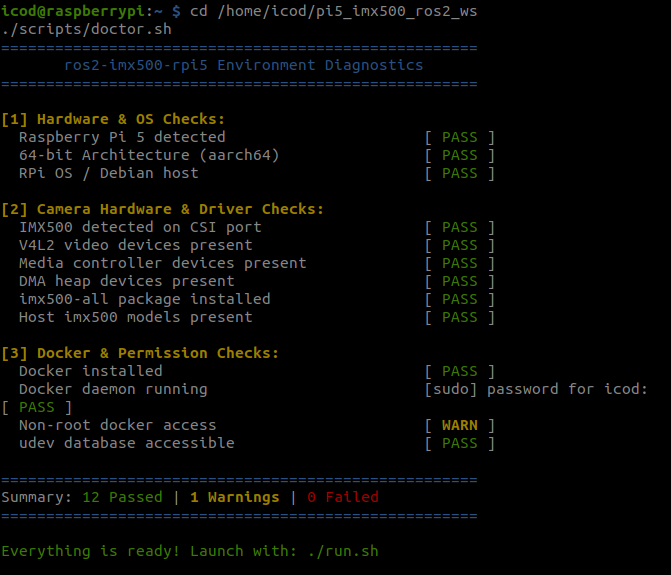

# Raspberry Pi 5 Host Setup & Environment Guide

The `ros2-imx500-rpi5` container relies on the Raspberry Pi 5 host for physical hardware drivers, device nodes, and kernel firmware support.

Before launching the Docker container, the host operating system must be configured to load the Sony IMX500 kernel drivers, firmware blobs, and PiSP (Raspberry Pi Image Signal Processor) pipeline handlers.

---

## 1. Host Operating System Selection

The host **must** run Raspberry Pi OS (Debian-based). Standard Ubuntu cannot be used as the host OS because the proprietary IMX500 kernel modules and firmware packages are currently distributed only through Raspberry Pi OS repositories.

| Specification | Requirement | Verification Command | Expected Output |
| :--- | :--- | :--- | :--- |
| **OS Distribution** | Raspberry Pi OS 64-bit (Bookworm / Trixie) | `cat /etc/os-release \| grep PRETTY_NAME` | `Debian GNU/Linux 12 (bookworm)` or `13 (trixie)` |
| **Architecture** | `aarch64` (ARM 64-bit) | `uname -m` | `aarch64` |
| **Kernel Release** | 6.6+ with downstream patches | `uname -r` | Contains `+rpt-rpi-2712` |
| **Target Board** | Raspberry Pi 5 Model B | `cat /proc/device-tree/model` | `Raspberry Pi 5 Model B Rev 1.1` |

> [!IMPORTANT]
> Do **not** install Ubuntu 22.04 or 24.04 directly on the Raspberry Pi 5 hardware. Ubuntu hosts lack the downstream Raspberry Pi `pisp_be` and `imx500` kernel drivers. The Docker container itself provides Ubuntu 22.04 + ROS 2 Humble while running smoothly on top of the Raspberry Pi OS kernel.

---

## 2. Boot Configuration (`config.txt`)

Ensure camera auto-detection is enabled in your boot configuration file located at `/boot/firmware/config.txt`:

```ini
# /boot/firmware/config.txt

# Automatically detect camera sensors on CSI ports CAM0 and CAM1
camera_auto_detect=1

# Optional: Enable 64-bit kernel mode explicitly
arm_64bit=1
```

If you made changes to `/boot/firmware/config.txt`, reboot the Raspberry Pi:

```bash
sudo reboot
```

---

## 3. Install Host IMX500 Firmware & Models

Install the official Raspberry Pi IMX500 firmware package, user-space utilities, and pre-trained `.rpk` neural network models:

```bash
sudo apt update
sudo apt install -y imx500-all
```

This installs:
- IMX500 DSP firmware blobs in `/lib/firmware/`
- Pre-compiled INT8 models in `/usr/share/imx500-models/`
- Post-processing JSON configuration profiles in `/usr/share/rpi-camera-assets/`

---

## 4. Automated Environment Diagnostics (`doctor.sh`)

To verify that your host kernel, CSI hardware detection, device permissions, and Docker daemon are 100% ready, run the included `doctor.sh` script:

```bash
./scripts/doctor.sh
```

<p align="center">
  
  <br>
  <em>All-green environment diagnostics check verifying kernel, CSI camera detection, and Docker access.</em>
</p>

The script checks:
1. **Hardware & Architecture**: Verifies Raspberry Pi 5 hardware and `aarch64` 64-bit execution.
2. **Camera Hardware & Drivers**: Verifies CSI bus detection, `/dev/video*`, `/dev/media*`, and `/dev/dma_heap/*`.
3. **Firmware & Models**: Verifies `imx500-all` and pre-compiled models in `/usr/share/imx500-models/`.
4. **Docker Runtime & Permissions**: Verifies Docker daemon status and udev database accessibility.

---

## 5. Host-Level Hardware Verification

Before running Docker, test camera recognition directly on the host using `rpicam-apps`:

### List Detected Cameras

```bash
rpicam-hello --list-cameras
```

Expected output:

```text
Available cameras
-----------------
0 : imx500 [4056x3040 10-bit RGGB] (/base/axi/pcie@1000120000/rp1/i2c@88000/imx500@1a)
    Modes: 'SRGGB10_CSI2P' : 2028x1520 [30.00 fps - (0, 0)/4056x3040 crop]
                             4056x3040 [10.00 fps - (0, 0)/4056x3040 crop]
```

### Live Preview with On-Chip Object Detection

Verify on-chip inference using the host's pre-installed MobileNet SSD model:

```bash
rpicam-hello -t 5s --post-process-file /usr/share/rpi-camera-assets/imx500_mobilenet_ssd.json
```

If the camera preview opens with live bounding boxes drawn around detected objects, your host hardware and kernel drivers are verified and ready for containerized ROS 2 operation.

---

<div align="center">

| [Previous: **Master Overview**](../README.md) | [**Documentation Roadmap**](../README.md#documentation-roadmap) | [Next: **02 - Hardware & Avionics Setup**](hardware.md) |
| :--- | :---: | ---: |

</div>
