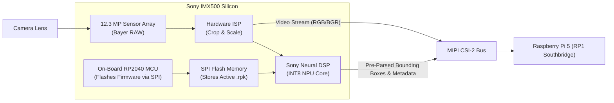

# RPK Model Conversion & Model Zoo Guide

The Sony IMX500 executes deep learning neural networks directly on its built-in digital signal processor (DSP) and neural processing unit (NPU). 

Models must be converted into Sony's proprietary `.rpk` (**Raspberry Pi Package**) format to run on the sensor's hardware accelerator.

---

## 1. Sony IMX500 Hardware Architecture



### The First-Run SPI Flash Behavior
When a new `.rpk` model is loaded for the first time:
- The on-board RP2040 microcontroller streams the neural network weights into the camera's non-volatile SPI flash memory.
- **This process takes 20–30 seconds on initial startup.**
- Once flashed, subsequent launches initialize in **under 1 second**.

---

## 2. Exporting Ultralytics YOLO to `.rpk` (PC Workflow)

Because model compilation, INT8 quantization, and graph optimization require substantial memory and x86_64 binaries, model conversion is performed on a PC workstation:

### Prerequisites (Workstation)
```bash
# Install Ultralytics and dependencies (Python 3.10+):
pip install ultralytics
```

### Export Command
Ultralytics natively supports direct export to the IMX500 `.rpk` format:

```bash
# Export YOLO11 Nano model with 640x640 input resolution:
yolo export model=yolo11n.pt format=imx500 imgsz=640
```

### Package Contents
The resulting `yolo11n.rpk` package encapsulates:
1. **Quantized INT8 Weights**: Optimized for the Sony DSP tensor core.
2. **On-Chip Post-Processing (PP)**: Anchor box decoding, score thresholding, and Non-Maximum Suppression (NMS) compiled to run directly on silicon.
3. **`network_info.txt`**: Model metadata including input tensor dimensions and class index mappings.

---

## 3. Pre-Compiled Raspberry Pi Model Zoo

For immediate deployment without manual conversion, Raspberry Pi provides certified `.rpk` models in the `imx500-all` package located at `/usr/share/imx500-models/`:

| Model File | Architecture | Input Tensor | Inference Rate | Best Suited For |
| :--- | :--- | :--- | :--- | :--- |
| `imx500_network_ssd_mobilenetv2_fpnlite_320x320_pp.rpk` | MobileNetV2 SSD | 320x320 | **15.0 FPS** | High-speed aerial tracking, lowest latency |
| `imx500_network_nanodet_plus_416x416_pp.rpk` | NanoDet-Plus | 416x416 | **10.0 FPS** | Balanced speed and spatial resolution |
| `yolo11n_640x640_pp.rpk` | Ultralytics YOLO11n | 640x640 | **7.5 FPS** | Maximum detection precision, small targets |
| `imx500_network_posenet.rpk` | PoseNet | 224x224 | **15.0 FPS** | Human skeletal keypoint tracking |
| `imx500_network_deeplabv3plus.rpk` | DeepLabV3+ | 257x257 | **5.0 FPS** | Dense terrain semantic segmentation |

---

## 4. Deploying & Testing Models on Raspberry Pi 5

### Transfer Custom Model from PC to Pi
```bash
scp yolo11n.rpk icod@<pi-ip>:~/models/
```

### Probe Model with `imx500_probe.py`
Before starting the ROS 2 node, verify that the camera DSP accepts and executes the model:

```bash
./run.sh -v $HOME/models:/models -- python3 examples/imx500_probe.py /models/yolo11n.rpk 10
```

Expected output:
```text
[probe] Loading model: /models/yolo11n.rpk
[probe] Uploading network firmware to IMX500...
[probe] Capturing for 10s ...

============================================================
  IMX500 Probe Results
============================================================
  Capture FPS (SensorTimestamp):  30.0
  Mean exposure time:            12.4 ms
  First inference arrived at:    1.24 s
  Best detection score:          0.89
============================================================
```

### Launch ROS 2 Publisher with the Model
```bash
./run.sh -v $HOME/models:/models -- python3 scripts/imx500_publisher.py --ros-args -p model_path:=/models/yolo11n.rpk
```

---

<div align="center">

| [⬅️ Previous: **06 - IMX500 ROS 2 Publisher Node**](publisher-node.md) | [📖 **Documentation Roadmap**](../README.md#documentation-roadmap) | [➡️ Next: **08 - Verified Benchmarks & Telemetry**](performance.md) |
| :--- | :---: | ---: |

</div>
