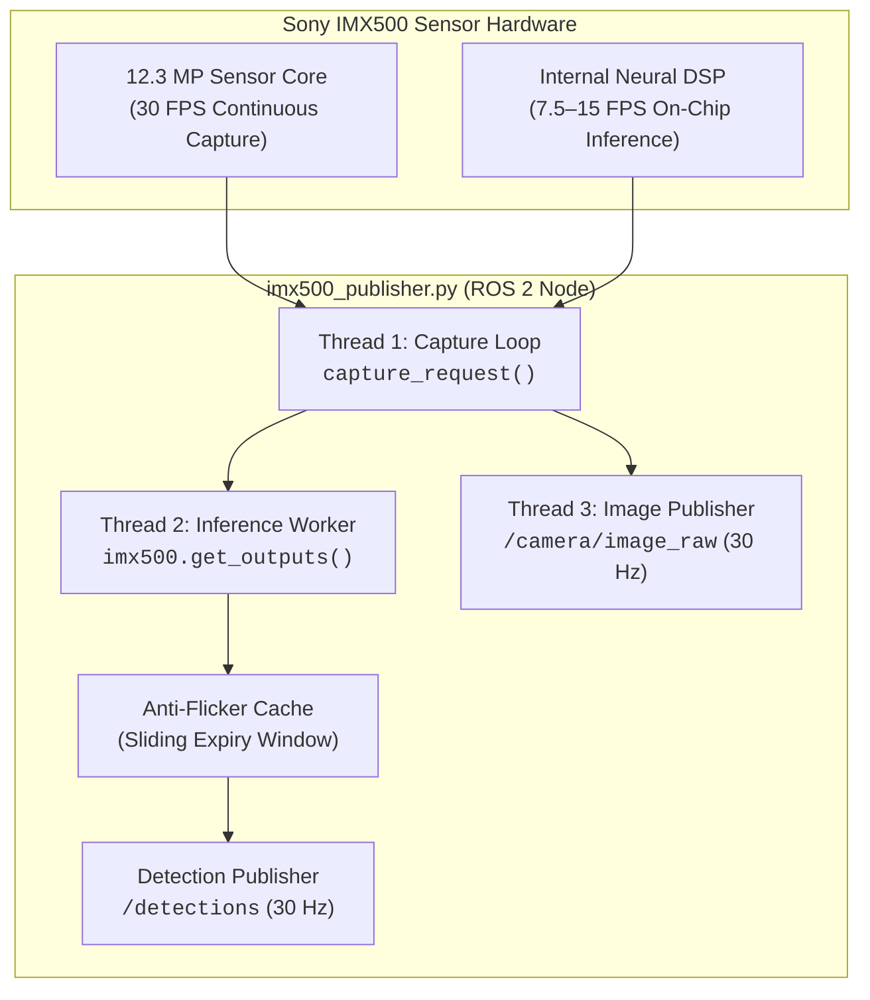

# IMX500 ROS 2 Publisher Node

The [`imx500_publisher.py`](../scripts/imx500_publisher.py) node is a high-performance Python node that bridges the Sony IMX500 camera and on-chip neural accelerator to ROS 2 Humble.

It publishes raw camera frames as `sensor_msgs/Image` at **30.0 FPS** while simultaneously outputting real-time neural network bounding boxes as `vision_msgs/Detection2DArray` with zero CPU inference overhead.

---

## 1. Node Architecture & Threading Model



### Multi-Threaded Design
1. **Capture Thread**: Grabs raw Bayer/RGB frames and hardware metadata requests from the Picamera2 driver.
2. **Inference Worker**: Decodes on-chip bounding boxes, maps normalized sensor coordinates to the target output resolution, and filters by confidence.
3. **Image Publisher Thread**: Converts OpenCV frames to ROS 2 messages via `CvBridge` and transmits over DDS using best-effort `qos_profile_sensor_data`.

---

## 2. Published ROS 2 Topics

| Topic | Message Type | QoS Profile | Rate | Description |
| :--- | :--- | :--- | :--- | :--- |
| `/camera/image_raw` | `sensor_msgs/msg/Image` | `SensorData` (Best Effort) | **30.0 Hz** | Continuous camera video stream (default 640x480 BGR8) |
| `/detections` | `vision_msgs/msg/Detection2DArray` | `SensorData` (Best Effort) | **30.0 Hz** | 2D bounding boxes, class labels, and confidence scores |

---

## 3. Node Parameters

| Parameter | Type | Default | Description |
| :--- | :--- | :--- | :--- |
| `resolution` | `string` | `"640x480"` | Output frame dimensions (`WIDTHxHEIGHT`) |
| `fps` | `int` | `30` | Camera capture frame rate |
| `model_path` | `string` | `"imx500_network_ssd_mobilenetv2_fpnlite_320x320_pp.rpk"` | Filepath or filename of the `.rpk` model |
| `conf_threshold` | `float` | `0.50` | Minimum detection confidence score (0.0 to 1.0) |
| `nms_threshold` | `float` | `0.45` | Non-Maximum Suppression overlap threshold |
| `target_class` | `int` | `0` | Primary detection class index (e.g. `0` for person in COCO) |
| `target_label` | `string` | `"person"` | Human-readable string for telemetry display |
| `max_cache_age_sec` | `float` | `0.4` | Anti-flicker expiration window in seconds |

---

## 4. Anti-Flicker Caching Mechanism

A major challenge in hardware-accelerated embedded vision is the **cadence mismatch** between camera frame rates and neural network inference times:

- Camera video stream captures at **30.0 FPS** (every 33.3 ms).
- On-chip INT8 inference executes at **7.5 to 15.0 FPS** (every 66.7 to 133.3 ms).

Without intelligent caching, intermediate video frames would publish empty detection arrays, causing downstream flight controllers and visual servoing tracking algorithms to flicker or drop tracks.

### How Anti-Flicker Works:
1. When a fresh inference output arrives from the IMX500 DSP, it is timestamped and cached.
2. During frames where the DSP is still computing, the node publishes the cached detection so the downstream control loop remains smooth and stable.
3. If no new inference is produced within `max_cache_age_sec` (e.g., target left the field of view), the cache expires cleanly, preventing ghost detections.

---

## 5. Launching the Publisher Node

### Default Launch (MobileNet SSD 320x320)
```bash
./run.sh -- python3 scripts/imx500_publisher.py
```

### Custom Model & Resolution Launch
```bash
./run.sh -- python3 scripts/imx500_publisher.py --ros-args \
  -p resolution:=640x480 \
  -p fps:=30 \
  -p model_path:=/usr/share/imx500-models/imx500_network_nanodet_plus_416x416_pp.rpk \
  -p conf_threshold:=0.55 \
  -p target_label:=person
```

### Runtime Dynamic Reconfiguration
Parameters can be tuned dynamically during flight without restarting the node:

```bash
# Adjust confidence threshold in real time:
ros2 param set /imx500_publisher conf_threshold 0.65

# Change cache expiration window:
ros2 param set /imx500_publisher max_cache_age_sec 0.25
```

---

<div align="center">

| [⬅️ Previous: **05 - Running Containers & Orchestration**](running.md) | [📖 **Documentation Roadmap**](../README.md#documentation-roadmap) | [➡️ Next: **07 - RPK Model Conversion & Zoo**](model-conversion.md) |
| :--- | :---: | ---: |

</div>

